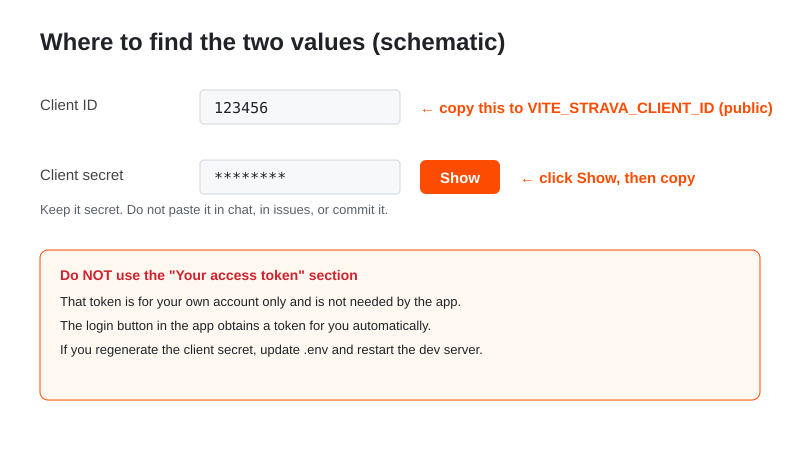

# RunPostcard

Turn one of your Strava runs into a postcard: a modern graphic with the route and your stats, ready to share or to place over a photo.

Status: stage 1 (Strava login, list of recent runs, default 9:16 postcard, PNG download).

## Strava app registration (required)

Every user runs their own copy of the app with their own Strava API application. Without it, the login button does not work. This takes about 5 minutes and you do it once.

### Step 1. Create the application

1. Log in to Strava in your browser, then open <https://www.strava.com/settings/api>.
2. Fill in the form:
   - **Application name:** anything, e.g. `RunPostcard`.
   - **Category:** any, e.g. `Visualizer`.
   - **Website** (required): any public page for your project, e.g. your GitHub repository URL.
   - **Authorization Callback Domain** (required):
     - local development: exactly `localhost` (no `http://`, no port),
     - Vercel: your deployment domain only, e.g. `your-app.vercel.app`.
   - Accept the Strava API Agreement and click **Create**.


3. Strava asks for an app icon. You can upload [docs/assets/app-icon.png](docs/assets/app-icon.png) or your own image.

### Step 2. Copy the Client ID and Client Secret

After creating the app, the application page shows:

- **Client ID** (a number). It is public. Copy it.
- **Client secret**. Click **Show**, then copy it. It is secret.



Do not use the **Your access token** section. The app gets its own token when you log in.

### Step 3. Create the `.env` file

In the project root (next to `package.json`), copy `.env.example` to `.env`. On Windows you can copy the file in Explorer and rename it, or run `copy .env.example .env` in a terminal.

## Environment variables

Fill in the two values in `.env`:

```
VITE_STRAVA_CLIENT_ID=your-client-id
STRAVA_CLIENT_SECRET=your-client-secret
```

- `VITE_STRAVA_CLIENT_ID` is public (it appears in the authorization URL).
- `STRAVA_CLIENT_SECRET` is secret. It is read only by the server side (`server/stravaToken.ts`) and never sent to the browser. Never commit `.env`.

## Run locally

```sh
npm install
npm run dev
```

Open <http://localhost:5173>. The local dev server serves `POST /api/strava/token` itself.

Other scripts: `npm test` (Vitest), `npm run typecheck`, `npm run build`, `npm run preview`.

Restart `npm run dev` after changing `.env`. Vite reads it only at startup.

### Testing the login

1. Open <http://localhost:5173> and click **Connect with Strava**.
2. Strava asks you to log in (if you are not logged in) and to allow access to your activities.
3. You are sent back to the app, and your recent runs appear in the list.

If something goes wrong, see **Troubleshooting** below.

## Troubleshooting

| What you see | Cause | Fix |
| --- | --- | --- |
| Strava page says `client_id: undefined` or `"code":"invalid"` | `.env` is missing or `VITE_STRAVA_CLIENT_ID` is empty | Check `.env` is in the project root, restart `npm run dev` |
| Strava page says the redirect URI is invalid | Callback domain in Strava is not `localhost` | Set **Authorization Callback Domain** to exactly `localhost` |
| The token request returns `500` "not configured" | `STRAVA_CLIENT_SECRET` is empty | Paste the secret into `.env`, restart `npm run dev` |
| The token request returns `401` "Strava rejected the code or token" | Wrong secret, or the login code expired | Check the secret, then click **Connect with Strava** again |
| Strava page says "Authorization limit reached" (403) right after you logged out and back in | Strava counts connected athletes; after you log out, the freed slot can take a moment to clear on Strava's side | Wait about a minute, then click **Connect with Strava** again |
| The list is empty | You have no runs with GPS (they are hidden on purpose) | Expected; try another account or a run with a route |

## Deploy on Vercel

1. Import the repository in Vercel. Framework preset: Vite. Build command: `npm run build`. Output directory: `dist`.
2. Add the environment variables `VITE_STRAVA_CLIENT_ID` and `STRAVA_CLIENT_SECRET` in the project settings. The client ID must be set here too, because the browser build reads it at build time.
3. Deploy, then put the Vercel domain into the Strava **Authorization Callback Domain** (see above).

The token endpoint is `api/strava/token.ts` (Vercel function), which calls the same logic as the local dev server.

## Other hosts

Vercel and local Node are the officially supported setups. Other hosting platforms may work if they serve the Vite build and the `/api/strava/token` route, but there is **no guarantee**.

## Privacy

- Access tokens are kept in `sessionStorage` in your browser and disappear when the tab is closed.
- Strava activity data is requested directly from the browser. Nothing is stored on the server, and there is no database.
- The app requests the `activity:read` scope only, so Strava hides privacy-zone sections of the route.

## Maps

Route thumbnails and the **Map** postcard background are a minimalist outline (streets, buildings, water, greenery) drawn by the app as SVG from vector tiles by [OpenFreeMap](https://openfreemap.org) ([OpenMapTiles](https://openmaptiles.org) schema, [OpenStreetMap](https://www.openstreetmap.org/copyright) data). No API key or configuration is needed. The attribution "Map: OpenFreeMap © OpenMapTiles © OpenStreetMap contributors" is shown under the run list, and "© OpenMapTiles © OpenStreetMap contributors" on postcards with the map background.

With the Map background you can pick a map theme: **Minimal** (the outline above), **8-bit** (a retro game town: coarse pixel grid, limited palette, houses, tower blocks and trees, stepped route) or **Fantasy** (parchment, castles, trees, a dragon, a compass rose and a banner with the run name). Themes are generated from the same map data and placed the same way every time for a given run. All theme icons are drawn in code, so there are no extra image files or licenses. Route thumbnails always use the minimalist outline.

- Your browser downloads the tiles directly from `tiles.openfreemap.org` (served through Cloudflare), so OpenFreeMap and Cloudflare can see the area of your run (approximate location).
- With the map background, the postcard shows the surroundings of the start and finish of your run, which may reveal where you live. Strava privacy zones still apply to the route.
- OpenFreeMap is a free external service without an SLA; its terms and availability are outside this project's control. The app sends at most 4 tile requests at a time.

## License and third-party notes

- The code is released under the MIT license.
- The "Connect with Strava" button and the "Powered by Strava" marks (`src/assets/brand/strava/`) are the official Strava brand assets, used without modification.
- The postcard font is Barlow Condensed Bold, under the SIL Open Font License (`public/fonts/OFL.txt`).
- Map data: OpenFreeMap, © OpenMapTiles, © OpenStreetMap contributors (see **Maps** above).
