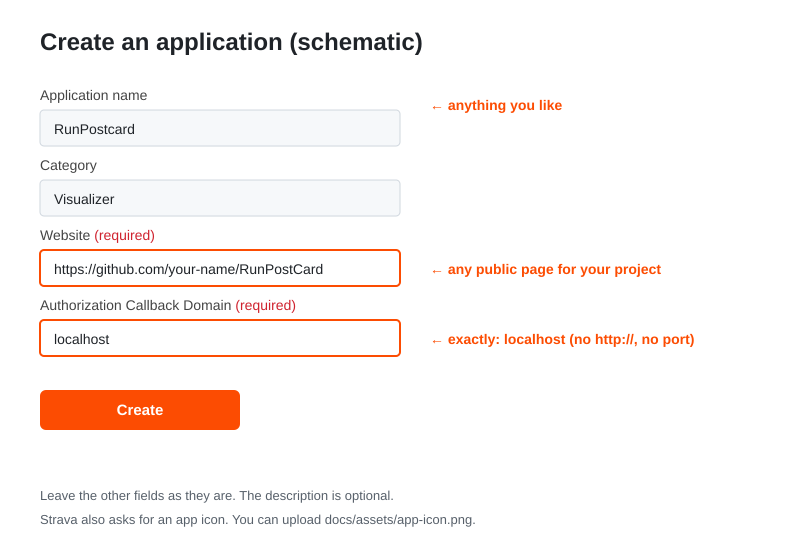

# RunPostcard

Turn one of your Strava runs into a postcard: a modern graphic with the route and your stats, ready to share or to place over a photo.

Status: stage 1 (Strava login, list of recent runs, default 9:16 postcard, PNG download).

## Strava app registration (required)

Every user runs their own copy of the app with their own Strava API application. Without it, the login button does not work. This takes about 5 minutes and you do it once.

### Step 1. Create the application

1. Log in to Strava in your browser, then open <https://www.strava.com/settings/api>.
2. Fill in the form:
   - **Application name:** anything, e.g. `RunPostcard`.
   - **Category:** any, e.g. `Visualizer`.
   - **Website** (required): any public page for your project, e.g. your GitHub repository URL.
   - **Authorization Callback Domain** (required):
     - local development: exactly `localhost` (no `http://`, no port),
     - Vercel: your deployment domain only, e.g. `your-app.vercel.app`.
   - Accept the Strava API Agreement and click **Create**.



3. Strava asks for an app icon. You can upload [docs/assets/app-icon.png](docs/assets/app-icon.png) or your own image.

### Step 2. Copy the Client ID and Client Secret

After creating the app, the application page shows:

- **Client ID** (a number). It is public. Copy it.
- **Client secret**. Click **Show**, then copy it. It is secret.


Do not use the **Your access token** section. The app gets its own token when you log in.

### Step 3. Create the `.env` file

In the project root (next to `package.json`), copy `.env.example` to `.env`. On Windows you can copy the file in Explorer and rename it, or run `copy .env.example .env` in a terminal.

## Environment variables

Fill in the two values in `.env`:

```
VITE_STRAVA_CLIENT_ID=your-client-id
STRAVA_CLIENT_SECRET=your-client-secret
```

- `VITE_STRAVA_CLIENT_ID` is public (it appears in the authorization URL).
- `STRAVA_CLIENT_SECRET` is secret. It is read only by the server side (`server/stravaToken.ts`) and never sent to the browser. Never commit `.env`.

## Run locally

```sh
npm install
npm run dev
```

Open <http://localhost:5173>. The local dev server serves `POST /api/strava/token` itself.

Other scripts: `npm test` (Vitest), `npm run typecheck`, `npm run build`, `npm run preview`.

Restart `npm run dev` after changing `.env`. Vite reads it only at startup.

### Testing the login

1. Open <http://localhost:5173> and click **Connect with Strava**.
2. Strava asks you to log in (if you are not logged in) and to allow access to your activities.
3. You are sent back to the app, and your recent runs appear in the list.

The run list starts with totals for the loaded runs (count, distance, moving time, elevation gain). Each tile shows the route on the map outline, the distance, pace, moving time, elevation gain, average heart rate (if recorded) and the date; the longest run gets a **Longest** badge. Hovering or focusing a tile draws its route. Animations are off when your system asks for reduced motion.

If something goes wrong, see **Troubleshooting** below.

## Troubleshooting

| What you see | Cause | Fix |
| --- | --- | --- |
| Strava page says `client_id: undefined` or `"code":"invalid"` | `.env` is missing or `VITE_STRAVA_CLIENT_ID` is empty | Check `.env` is in the project root, restart `npm run dev` |
| Strava page says the redirect URI is invalid | Callback domain in Strava is not `localhost` | Set **Authorization Callback Domain** to exactly `localhost` |
| The token request returns `500` "not configured" | `STRAVA_CLIENT_SECRET` is empty | Paste the secret into `.env`, restart `npm run dev` |
| The token request returns `401` "Strava rejected the code or token" | Wrong secret, or the login code expired | Check the secret, then click **Connect with Strava** again |
| Strava page says "Authorization limit reached" (403) right after you logged out and back in | Strava counts connected athletes; after you log out, the freed slot can take a moment to clear on Strava's side | Wait about a minute, then click **Connect with Strava** again |
| The list is empty | You have no runs with GPS (they are hidden on purpose) | Expected; try another account or a run with a route |

## Deploy on Vercel

1. Import the repository in Vercel. Framework preset: Vite. Build command: `npm run build`. Output directory: `dist`.
2. Add the environment variables `VITE_STRAVA_CLIENT_ID` and `STRAVA_CLIENT_SECRET` in the project settings. The client ID must be set here too, because the browser build reads it at build time.
3. Deploy, then put the Vercel domain into the Strava **Authorization Callback Domain** (see above).

The token endpoint is `api/strava/token.ts` (Vercel function), which calls the same logic as the local dev server.

## Other hosts

Vercel and local Node are the officially supported setups. Other hosting platforms may work if they serve the Vite build and the `/api/strava/token` route, but there is **no guarantee**.

## Privacy

- Access tokens are kept in `sessionStorage` in your browser and disappear when the tab is closed.
- Strava activity data is requested directly from the browser. Nothing is stored on the server, and there is no database.
- The app requests the `activity:read` scope only, so Strava hides privacy-zone sections of the route.
- With **Terrain** on, elevation tiles for the area of the run are downloaded from AWS (`s3.amazonaws.com`); see **Terrain** below.
- A **Photo** background never leaves your browser. The app rescales it to the postcard size and re-saves it as JPEG, which removes EXIF metadata (including GPS location).
- **Behind** (Photo background only) finds the runner in your photo in the browser with MediaPipe; the photo is never uploaded. The MediaPipe library normally sends anonymous usage metrics to Google (`odml.pa.googleapis.com`); the app blocks that request (`src/lib/segment.ts`), so nothing leaves the browser.

## Maps

Route thumbnails and the **Map** postcard background are a minimalist outline (streets, buildings, water, greenery) drawn by the app as SVG from vector tiles by [OpenFreeMap](https://openfreemap.org) ([OpenMapTiles](https://openmaptiles.org) schema, [OpenStreetMap](https://www.openstreetmap.org/copyright) data). No API key or configuration is needed. The attribution "Map: OpenFreeMap © OpenMapTiles © OpenStreetMap contributors" is shown under the run list, and "© OpenMapTiles © OpenStreetMap contributors" on postcards with the map background (small, running up the right edge; it is part of the exported image).

The style panel is split into sections, each a drop-down list whose options show a preview: **Background** (Gradient, Transparent, Photo with a **Dim** slider, an **Edit photo** button and a **Behind** toggle, or Map), **Map style** (shown with a map background), **View**, **Font** and **Layout**; on a wide screen they sit in pairs side by side. With a map background, the same map fills the whole screen behind the panel (also in 3D, as the floor around the route), dimmed outside the white frame; only the framed postcard is downloaded.

There are 33 map themes. Classic and stylized: **Dark** (the outline above), **Light**, **Neon** (glowing streets and route; pick pink, red, orange, yellow, green, cyan, violet or any custom color), **Blueprint**, **Pencil**, **Watercolor**, **Vintage**, **Riso**, **Chalk**, **Halftone**, **Synthwave**, **Terminal** and **Ink**. Inspired by film and game moods (generic looks, no brands or characters): **Digital Rain**, **Light Grid**, **Galaxy**, **Desert**, **Red Fog**, **Spellbook**, **Pop Comic**, **Bricks**, **Arcade Maze** and **Dollhouse**. In the style of video-game genres: **Handheld**, **Vector Arcade**, **Dungeon**, **Space Shooter**, **Voxel**, **Night Vision**, **Kart Race**, **Cyber HUD**, **Overworld** and **Pinball**. Each map theme sets a matching font when you pick it; you can change the font afterwards. Map themes always include land use (residential, industrial, schools and hospitals, sports grounds, fields), railways (dashed), road tunnels (dashed), bridges and airport runways. Street and place names are never drawn. Map tiles are hidden for runs without a route. Themes only change colors, line styles, glow and paper textures; they use the same map data. Thumbnails in the run list always use the minimalist outline.

**Edit photo** (the sliders icon next to Dim) opens a window with a 9:16 preview: drag to move the photo, use the slider, the mouse wheel or a pinch to zoom, and pick one of 8 color presets (B&W, Noir, Vivid, Dramatic, Sepia, Warm, Cool, Fade). **Apply** bakes the edit into the postcard photo; it is always made from the original file, so repeated edits do not lose quality. Everything is processed locally in the browser.

**Behind** (Photo background only, off by default) cuts the runner out of your photo and places them in front of the postcard: the upper part of the route and the big numbers go behind the runner, the lower part of the route, labels, charts and the Strava mark stay on top. The first time you switch it on, the segmentation model (~16 MB) and the MediaPipe runtime (~14 MB wasm) are loaded from the app's own server; the photo is processed locally and never leaves the browser. The upper part of the route always goes behind the cut-out; the numbers always stay in front, so they stay readable. **Pick object** lets you tap any object on the photo instead (loads a second, ~6 MB model on first use); **Auto** goes back to the runner. If no person is found, the postcard looks as without it. Downloads wait until the cut-out is ready.

**View**: drag, pinch, or use the mouse wheel (Ctrl + wheel at zoom 1) to zoom and move the route and map, in the flat view and in 3D; dragging works at zoom 1 too, and the map fills the area that comes into view. **Reset view** (shown once you have zoomed or moved) goes back. When you stop moving, denser tiles are loaded for the visible part so streets stay sharp.

**Line** (in the **View** section, when the route is shown) colors the route: **Theme** (the map theme's color; in 3D colored by slope), **Rainbow**, **Pace** (blue for the fastest parts, red for the slowest), **Heart rate** (zone colors) or **Elevation** (green low, red high). Pace, Heart rate and Elevation need the run's streams and are disabled without them.

**Font** picks the postcard font: 20 fonts grouped as Sport, Tech, Retro and Script, each option previewed in its own font (see the license notes below). The preview fonts are downloaded only when you first open the list. Each font has its own size factor so the stats stay in their columns; very wide fonts (Press Start 2P, Rubik Mono One) are drawn smaller.

**Layout** picks how the stats are arranged: Classic, Hero, Grid 2x2, Dashboard, Stack left, Top & bottom, Minimal, Magazine (with the run name), Corners, Big pair, and nine layouts with chart areas: Poster, HUD, Scoreboard, Split sheet, Pulse, Two charts, Climb, Top strip and Stats & table. To change what a stat shows, click it on the postcard (or focus it with Tab and press Enter): a dialog lists the available data with a small preview of each, drawn in your font and colors. Numbers: distance, moving time, elapsed time, pace, average and max heart rate, elevation gain, average and max speed, cadence, run name, date and start time. Charts (only in chart areas, from the run's streams): elevation profile, heart rate line colored by zone, pace per km bars with the fastest kilometre highlighted, a heart rate zone ring, speed and cadence lines, a heart rate histogram (time per 5 bpm), grade per km bars (orange uphill, blue downhill), cumulative climb, speed vs heart rate dots, a table of the three fastest kilometres, and the elevation gain number with a small elevation profile. Heart rate zones are approximate (60/70/80/90% of the max heart rate), because the athlete's own zones need another Strava permission. Without streams, a chart area shows the number instead. Data your activity does not have is shown as "–". Picking data that is already on the postcard swaps the two. Each layout remembers its own choices while the page is open.
**Download** opens a menu with **PNG image**, **SVG (vector)**, **Video (MP4)** and **GIF (animated)**. The two animations draw the route from start to finish with a small runner dot at its head while the distance and moving time count up, then hold on the finished postcard: MP4 is 1080x1920 at 30 fps (about 6 s plus a 1.5 s hold), meant for Stories; GIF is 432x768 at 10 fps and loops forever, meant for chats. Both are made in your browser, frame by frame, with a progress bar and **Cancel**; this takes a while (roughly 10–30 s). MP4 needs H.264 encoding through WebCodecs; in browsers without it the item is greyed out ("not supported in this browser") and GIF still works. A transparent background turns black in both. After the file is downloaded, phones that can share files show a **Share** button that opens the system share sheet, from which you can post it to Instagram Stories or attach it to your activity in the Strava app by hand (the Strava API does not let apps upload photos or videos).

## 3D view

When you open a postcard, the app makes one extra Strava request for that run only: its streams (GPS points, distance, time, elevation, heart rate, speed). Nothing is cached; opening the postcard again fetches them again. If the request fails, the postcard works as before, without the 3D view.

- **Flat / 3D** (shown when the run has elevation data) draws the route in an isometric view, raised by elevation and colored by gradient (blue downhill, white flat, orange uphill). On flat runs the elevation is exaggerated so it stays visible. The route is smoothed for drawing and the exaggeration is capped at ×3, so flat runs look flat. With a map theme, the same map lies under the 3D route as its floor. Buildings stand on the floor as simple blocks, using the building heights from OpenStreetMap (10 m when a building has none), slightly exaggerated (×1.5) so they read at postcard scale; the route is always drawn on top. Up to 5000 of the largest buildings are drawn (3000 on the screen backdrop). When you zoom in (×1.5 and more) and stop moving, the app loads denser tiles for the visible part of the floor, so streets stay sharp; downloads wait until that part is loaded.

- Your browser downloads the tiles directly from `tiles.openfreemap.org` (served through Cloudflare), so OpenFreeMap and Cloudflare can see the area of your run (approximate location).
- With the map background, the postcard shows the surroundings of the start and finish of your run, which may reveal where you live. Strava privacy zones still apply to the route.
- OpenFreeMap is a free external service without an SLA; its terms and availability are outside this project's control. The app sends at most 4 tile requests at a time.

## Terrain

**Terrain** (in the **View** section, shown only for runs in hills or mountains, i.e. an elevation range of 300 m or more, with a map background) adds the relief of the land from elevation tiles: a hillshade over the map in the flat view, and in 3D a single-color relief (shaded from the theme's background color) that replaces the map floor and buildings, with the route lying on the slopes. For such runs it is on by default and you can switch it off; city and flat runs never show it. With terrain in 3D the route uses the terrain heights instead of the watch's, so it may differ slightly from the elevation numbers and charts, and it is always drawn on top (also behind a ridge). The relief is an image inside the SVG, so an exported SVG grows by about 1–3 MB. If the terrain cannot be loaded, the postcard silently stays as it was. Downloads wait until the terrain is loaded.

- Elevation data: [Terrain Tiles](https://registry.opendata.aws/terrain-tiles/) (Mapzen / Tilezen Joerd, AWS Open Data, Terrarium PNG, no API key, up to 32 tiles per postcard).
- Your browser downloads the tiles directly from `s3.amazonaws.com`, so Amazon Web Services can see the area of your run (approximate location), like OpenFreeMap for the map. Runs with terrain off download no terrain tiles.
- Postcards with terrain carry the short attribution "Terrain: Mapzen, USGS, Copernicus EU-DEM, NOAA and others" next to the map attribution. Full attribution (also shown under the panel while terrain is on): 3DEP (formerly NED), SRTM and GMTED2010 courtesy of the U.S. Geological Survey; EU-DEM produced using Copernicus data and information funded by the European Union; ETOPO1 by NOAA; Terrain Tiles by Mapzen; and regional sources listed in [the Joerd attribution document](https://github.com/tilezen/joerd/blob/master/docs/attribution.md). Terrain Tiles is a free service without an SLA.

## License and third-party notes

- The code is released under the MIT license.
- The "Connect with Strava" button and the "Powered by Strava" marks (`src/assets/brand/strava/`) are the official Strava brand assets, used without modification.
- Postcard fonts (`public/fonts/`): Barlow Condensed Bold, Bebas Neue, Anton, Oswald, Teko, Archivo Black, Russo One, Black Ops One, Space Grotesk, Orbitron, Audiowide, Rubik Mono One, Bungee, Monoton, Righteous, Racing Sans One, Press Start 2P, Pacifico and Lobster under the SIL Open Font License 1.1; Permanent Marker under the Apache License 2.0. License texts: `public/fonts/licenses/`.
- Person segmentation (**Behind**): the MediaPipe Selfie Segmentation multiclass model (`public/models/selfie_multiclass_256x256.tflite`, Google), the MediaPipe Interactive Segmenter model for **Pick object** (`public/models/magic_touch.tflite`, Google) and `@mediapipe/tasks-vision`, all under the Apache License 2.0. Notice: `public/models/LICENSE`.
- Animation export: [Mediabunny](https://github.com/Vanilagy/mediabunny) (MP4 muxing, Mozilla Public License 2.0) and [gifenc](https://github.com/mattdesl/gifenc) (GIF encoding, MIT), both loaded only when you export an animation.
- Map data: OpenFreeMap, © OpenMapTiles, © OpenStreetMap contributors (see **Maps** above).
- Login screen photos (`src/assets/collage/`, cropped and resized): CC0 1.0 via Wikimedia Commons (originally on Unsplash). 01 "Long road into the mountains" by Bruno Bergher; 02 "Winding mountain road" by adrian; 03 "Runner" by Jenny Hill; 04 "Running down Mount Tamalpais in gold" by Todd Diemer; 05 "Running in the rain" by Dominik Schröder; 06 "The Runner" and 07 "Ready, set, go" by William Stitt; 08 "Starting line" by Kolleen Gladden. The runner cut-outs in `src/assets/collage/cutouts/` (made once in dev with `src/dev/collageCutouts.ts`, no model runs on the login screen) are derived from photos 03, 06 and 07 and are under the same CC0 1.0.
- Elevation data: Terrain Tiles by Mapzen on AWS Open Data; USGS (3DEP, SRTM, GMTED2010), Copernicus EU-DEM, NOAA ETOPO1 and others (see **Terrain** above).
